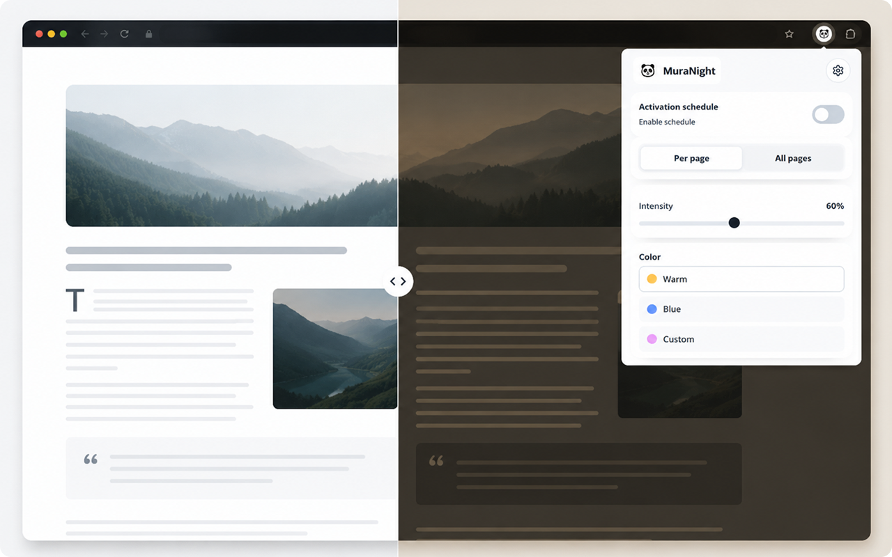

<p align="center">
  
</p>

# MuraNight (Chrome & Microsoft Edge)

A lightweight, zero-dependency Manifest V3 browser extension that applies a customizable night-mode tint/dim overlay and accessibility protections to web pages, either per exact URL (`origin + pathname + search`, ignoring `hash`) or globally.

## Features

- **Two Application Modes**:
  - **Per Page**: Independent activation per exact URL (including automatic SPA navigation tracking).
  - **All Pages**: Automatic global application across all supported websites.
- **Real-Time Intensity & Boost**:
  - Smooth control from `0%` up to `200%` (expandable up to `500%` in Settings) combining a color tint layer (`mix-blend-mode: multiply`) and a dimming layer.
- **Three Color Modes**:
  - **Warm**, **Blue**, and **Custom** (with live color picker and HEX input).
- **Activation Schedule**:
  - Automatically enables and disables night mode within a configurable daily time window.
- **Always-On Accessibility Protections**:
  - Reduce motion (clamps CSS transitions/animations and pauses autoplay videos), soften brightness, reduce strong colors, and mitigate flashes.
- **Local Profiles & Backup**:
  - Save, apply, and delete local presets, or export/import all settings and per-URL configurations as a `.txt` / `.json` file.
- **Multi-Language UI**:
  - Built-in localization for English, Portuguese (Brazil), Spanish, French, and German (automatic browser detection or manual selection).
- **Fullscreen Support**:
  - Automatically keeps the night-mode overlay active when videos or page elements enter fullscreen mode.

## Development & Build (Tailwind CSS)

- Source stylesheet: [`src/popup.tailwind.css`](src/popup.tailwind.css)
- Compiled output: [`popup.css`](popup.css)

```bash
# Install development dependencies
npm install

# Run unit and regression tests
npm test

# Compile minified popup CSS
npm run build:css

# Watch mode during UI development
npm run watch:css

# Run Chrome Web Store pre-release checks
npm run release:preflight

# Package runtime files into .release/muranight-v<version>.zip
npm run release
```

## Loading Unpacked in Chrome / Edge

1. Open `chrome://extensions` (or `edge://extensions`).
2. Enable **Developer mode**.
3. Click **Load unpacked**.
4. Select the root folder of this repository (`muranight`).

## Project Structure

- `manifest.json` — Manifest V3 extension configuration
- `content.js` — Content script injected at `document_start` (overlays, schedule timer, accessibility filters, and fullscreen/SPA tracking)
- `popup.html` / `popup.js` / `popup.css` — Popup UI and state management
- `src/popup.tailwind.css` — Tailwind CSS source and local `Open Sans` `@font-face` declarations
- `scripts/release/` — Pre-release validation (`preflight.mjs`), packaging (`package.mjs`), and version tracking (`mark-submitted.mjs`)
- `tests/` — Automated test suite (`extension.test.mjs`)

## License

Distributed under the [MIT License](LICENSE).
